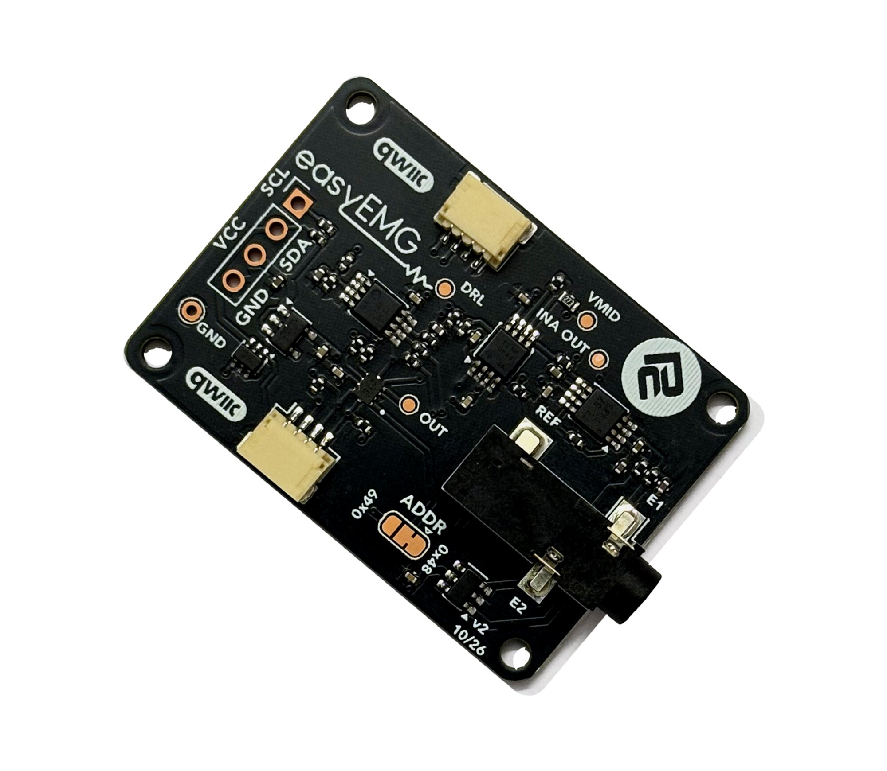

# ProtoCentral easyEMG Arduino Library

[](https://github.com/Protocentral/protocentral_easyemg_arduino/actions/workflows/arduino-lint.yml)
[](https://github.com/Protocentral/protocentral_easyemg_arduino/actions/workflows/compile-examples.yml)

Arduino library for the **ProtoCentral easyEMG Breakout**: single-channel surface EMG (sEMG) over I²C / Qwiic. Unlike an analog "muscle sensor", it gives you the raw band-limited waveform and computes the RMS envelope in software. It has no external dependencies.

## Don't have one? [Buy it here](https://protocentral.com/product/easyemg-surface-emg-breakout-qwiic/)



## Links

| | |
|---|---|
| Product page | https://protocentral.com/product/easyemg-surface-emg-breakout-qwiic/ |
| Hardware design files | https://github.com/Protocentral/protocentral_easyemg_hardware |
| easyISO isolated Qwiic adapter | https://protocentral.com/product/easyiso-isolated-qwiic-adapter/ |
| easyISO hardware design files | https://github.com/Protocentral/protocentral_easyiso_hardware |
| MicroPython + Raspberry Pi driver | https://github.com/Protocentral/protocentral-micropython-easyemg |
| OpenView companion app | https://github.com/Protocentral/protocentral_openview |
| INA333 datasheet | https://www.ti.com/lit/ds/symlink/ina333.pdf |
| OPA2333 datasheet | https://www.ti.com/lit/ds/symlink/opa2333.pdf |
| TLA2024 datasheet | https://www.ti.com/lit/ds/symlink/tla2024.pdf |

## How it works

An INA333 and two OPA2333 stages give a total gain of about ×51.7, fixed by the onboard resistors, and a passband of about 20–310 Hz. A TLA2024 12-bit ADC reads the signal against the board's buffered 1.65 V mid-rail, at about 2.42 µV per count at the electrodes.

The board has no data-ready pin, so your host polls the ADC. The rate you get depends on the host and the I²C clock: `07.Diagnostics` prints it, and an UNO R4 at 400 kHz reaches about 1958 SPS. The [easyECG](https://github.com/Protocentral/protocentral_easyecg_arduino) uses the same circuit with ECG component values.

## Features

- Raw sEMG waveform in µV at the electrodes
- Sliding-window RMS envelope
- Muscle-activation detection, with a threshold you set from your own noise floor
- %MVC normalisation, to compare effort across subjects and sessions
- One-call baseline zeroing
- Optional software mains notch and digital high-pass
- No dependencies. Runs on AVR, Uno R4, Nano 33 BLE, ESP32 and RP2040

> **Not a medical device. For research and education only.** The breakout has no patient isolation: when electrodes are on a person, power the host from a battery or connect through an [easyISO isolated Qwiic adapter](https://protocentral.com/product/easyiso-isolated-qwiic-adapter/).

## Installation

- **Arduino Library Manager (recommended):** search for and install **ProtoCentral easyEMG**.
- **Manual:** download this repository as a ZIP, then use **Sketch → Include Library → Add .ZIP Library…**

## Wiring

Connect the board with a Qwiic / STEMMA QT cable, or use the header:

| Breakout | MCU |
|---|---|
| VCC | 3.3 V or 5 V (header only; Qwiic is 3.3 V) |
| GND | GND |
| SDA | I²C SDA |
| SCL | I²C SCL |

The default I²C address is **`0x48`**. To move it to **`0x49`**, cut JP1 and bridge 2–3, then use `easyEMG emg(EASYEMG_I2C_ADDR_ALT);`. An easyECG ships at 0x49, so the two share a Qwiic bus without touching the jumper.

### Electrode placement

| Jack contact | Signal | Placement |
|---|---|---|
| Sleeve | E1 | Muscle belly |
| Ring | E2 | Muscle belly, about 20 mm from E1, along the fibres |
| Tip | REF | Bony landmark away from muscle: elbow or wrist |

For a clean trace, wipe the skin with alcohol and let it dry, and use fresh gel electrodes.

## Quick Start

```cpp
#include <Wire.h>
#include "ProtoCentral_easyEMG.h"

easyEMG emg;

void setup() {
    Serial.begin(115200);
    if (!emg.begin()) {
        Serial.println("easyEMG not found");
        while (1);
    }
    emg.calibrateBaseline();              // relax the muscle for this
    emg.setEnvelopeWindow(64);
}

void loop() {
    float envelope = emg.readEnvelope();  // takes a sample, returns RMS in uV
    Serial.print(emg.lastRaw());          // the same sample, in ADC counts
    Serial.print('\t');
    Serial.println(envelope, 1);
}
```

Take one sample per loop. `readEnvelope()` reads the ADC, and `lastRaw()` and `lastMicrovolts()` return that same sample. Calling `readRaw()` afterwards would take a second conversion.

## API Reference

| Method | Description |
|---|---|
| `easyEMG(i2cAddress = 0x48)` | `EASYEMG_I2C_ADDR_ALT` = 0x49 |
| `bool begin(TwoWire& wirePort = Wire)` | Configure the ADC. True if it ACKs |
| `float readMicrovolts()` / `int16_t readRaw()` | One sample, in µV at the electrodes / in counts |
| `setEnvelopeWindow(samples)` | 1–128, default 64. In samples, not milliseconds |
| `float envelopeWindowMillis(sampleRateHz)` | The window in ms, at your sample rate |
| `float readEnvelope()` / `int16_t readEnvelopeRaw()` | Take a sample and return the RMS, in µV / in counts |
| `float lastEnvelope()` / `lastRaw()` / `lastMicrovolts()` | The last results, with no new sample |
| `calibrateBaseline(samples = 256)` | Measure and subtract the resting offset |
| `setActivationThreshold(uV)` / `bool isActive()` | Compare the last envelope with a threshold |
| `setMVC(uV)` / `float readPercentMVC()` | Last envelope as a percentage of MVC |
| `bool setNotch(mainsHz, sampleRateHz, q = 4.0f)` / `disableNotch()` | Software mains notch, off by default |
| `bool setHighPass(cornerHz, sampleRateHz)` / `disableHighPass()` | 2nd-order digital high-pass, off by default |

The full API is documented in [ProtoCentral_easyEMG.h](src/ProtoCentral_easyEMG.h).

## Notch and high-pass

Both filters need your exact sample rate, so sample on a timed schedule, as `06.OpenView` does at a fixed 1000 SPS. The notch is only about 12.5 Hz wide at 50 Hz, so the average rate of a free-running loop isn't accurate enough.

The notch also removes real signal. Fix the usual causes first: a REF electrode on muscle instead of bone, dried-out gel or a mains-powered host. `07.Diagnostics` reports how much of your signal is mains.

## Examples

| # | Sketch | Description |
|---|---|---|
| 01 | `01.BasicReading` | Raw counts and µV in the Serial Monitor |
| 02 | `02.SerialPlotter` | Muscle activity in the Arduino Serial Plotter, with an adjustable plot rate |
| 03 | `03.Calibration` | Baseline zeroing and your resting noise floor |
| 04 | `04.EnvelopeRMS` | RMS envelope, MVC recording, %MVC and a live sample-rate readout |
| 05 | `05.MuscleActivation_LED` | Flex to light an LED, with an automatic threshold and hysteresis |
| 06 | `06.OpenView` | Stream to [OpenView](https://github.com/Protocentral/protocentral_openview) 3.4 or later, using the **easyEMG Breakout** profile |
| 07 | `07.Diagnostics` | I²C scan, CONFIG read-back, stuck-ADC check, sample rate and mains hum. **Run this first if something is wrong** |

All examples print at 115200 baud.

## Troubleshooting

Run `07.Diagnostics` first; it tells a silent board from a stuck ADC or mains hum. [TROUBLESHOOTING.md](TROUBLESHOOTING.md) has the full symptom-to-cause guide and the measurement traps to avoid.

## License

- **Software:** MIT
- **Hardware:** CERN-OHL-P v2
- **Documentation:** CC BY-SA 4.0

See [LICENSE.md](LICENSE.md). Copyright (c) 2026 ProtoCentral Electronics.

## Support

Open an issue on [GitHub](https://github.com/Protocentral/protocentral_easyemg_arduino/issues) or email support@protocentral.com.
